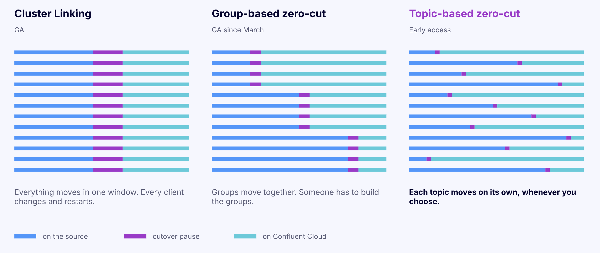
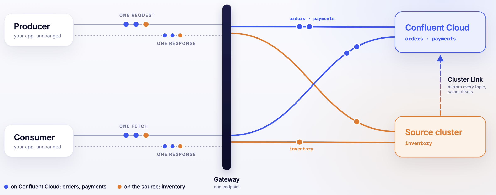
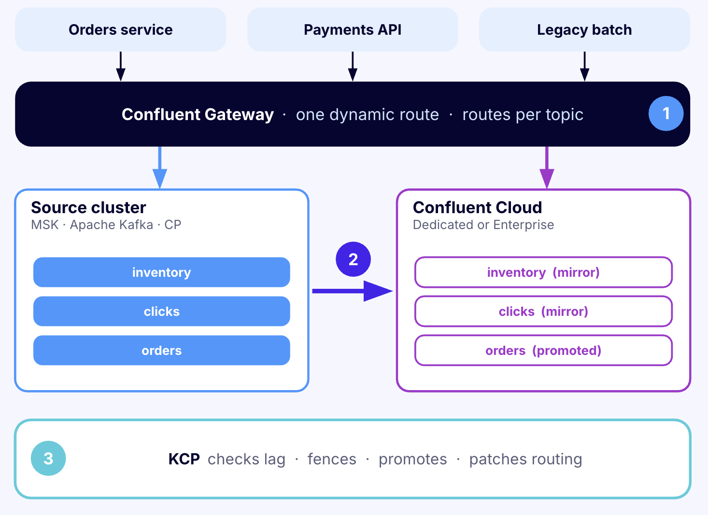
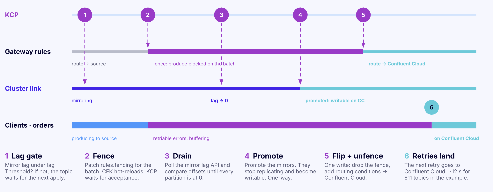
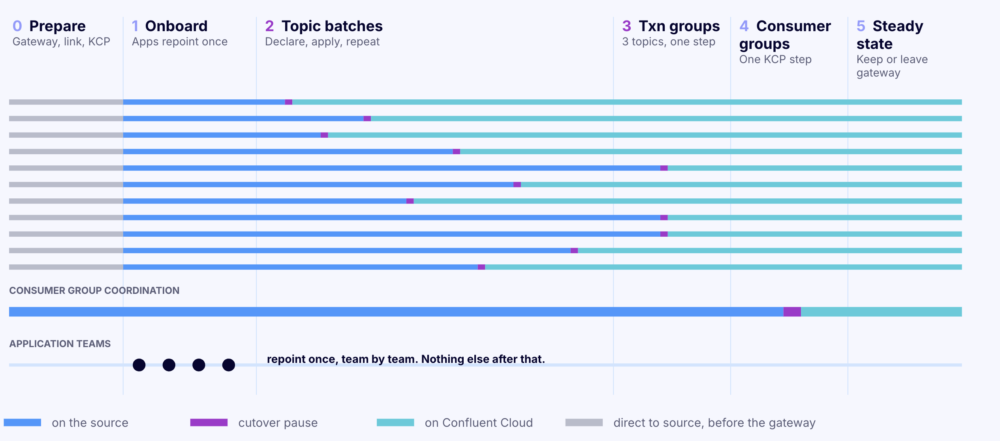
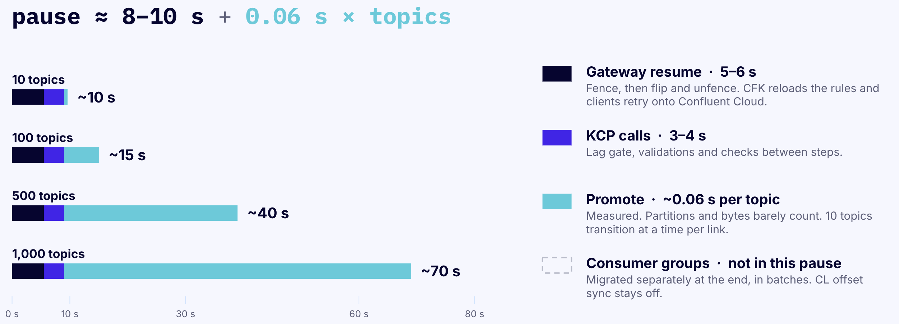

# Topic-Based Migration: Overview and Guide

## Move a Kafka estate one topic at a time

Topic-based migration moves topics from an existing Kafka cluster to Confluent Cloud one batch at a time, while producers and consumers keep running. Applications connect to a single address once, at the start. From then on, a platform team moves topics on its own schedule, and every application keeps reading and writing without a configuration change.

At any moment during the migration, some topics live on the old cluster and some on Confluent Cloud. Applications do not see the difference. A consumer can read one topic from the old cluster and another from Confluent Cloud in the same poll loop. When a topic moves, its clients pause briefly while the topic is fenced and then continue on Confluent Cloud from where they were.

This guide is for engineers who know Kafka well but are new to Confluent's migration tooling. It explains the problem, introduces each component from first principles, shows how a topic changes clusters under live traffic, and walks through a full migration. Field-by-field syntax lives in the [KCP documentation](https://confluentinc.github.io/kcp/0.0.0-preview/), the [Gateway topic-based routing guide](https://docs.confluent.io/private-cloud-gateway/current/gateway-topic-based-routing.html) and its [Confluent for Kubernetes version](https://docs.confluent.io/operator/current/gateway/co-gateway-topic-based-routing.html), and each section links to the relevant page.



## The problem with moving Kafka clients

Copying Kafka data between clusters is a solved problem with tools like Cluster Linking. In a typical cutover, every producer and consumer of a topic changes its `bootstrap.servers` and restarts in the same window, or data gets written to one cluster while consumers read from the other.

In a large estate, that window is hard to find. Hundreds of applications owned by dozens of teams read and write overlapping sets of topics. Before the first cutover, someone has to map which applications touch which topics, group topics that share clients, and get every owner in each group to deploy at the same time. The cutover takes minutes. The mapping and scheduling routinely take months.

Topic-based migration removes that dependency. Applications change their configuration once, at a time that suits each team, and never again. Topics then move individually, and no team needs to coordinate with another.

---

## The idea

Put a Kafka-aware proxy between the applications and the clusters. The proxy speaks the Kafka protocol, so clients treat it as an ordinary Kafka cluster. Behind it sit two clusters: the source and destination cluster. For every request, the proxy reads which topics the request names and forwards it to the cluster that currently owns those topics.

Migrating a topic then becomes a change of ownership inside the proxy, not a change in any application. Before the change, the proxy sends that topic's traffic to the source. After it, the proxy sends it to Confluent Cloud. All of this is coordinated with a cluster link that keeps a replica of each source topic with the same offsets on both clusters, which is what makes the client re-routing possible.



---

## The three components

### 1) Confluent Gateway: routes each topic to the right cluster

Confluent Gateway is the Kafka-aware proxy. It runs close to the applications, on Docker or on Kubernetes, and exposes one bootstrap address per route. Clients connect to it exactly as they would to a broker. The Gateway assigns its own broker IDs and addresses, so clients never connect to the real brokers behind it.

The Gateway configuration uses a few terms that appear throughout this guide:

- A **streaming domain** is one Kafka cluster as the Gateway knows it: its address and how the Gateway authenticates to it. A migration uses two, the source and Confluent Cloud.
- A **route** is a bootstrap address on the Gateway that clients connect to. A **static route** sends all its traffic to one cluster. A **dynamic route** is bound to both clusters and decides per topic.
- **Routing rules** on a dynamic route map topics to clusters. Topics with no rule go to the route's **default** cluster, which is the source at the start. Routing rules also name the one cluster that coordinates all consumer groups on the route.
- **Fencing rules** pause produce or consume traffic for named topics. A fenced produce request gets `NOT_ENOUGH_REPLICAS`, an error that Kafka clients treat as retriable, so producers hold their records and try again.

The Gateway also handles authentication. Clients log in to the Gateway, and the Gateway either relays that login to each cluster (passthrough) or replaces it with credentials for that cluster from a secret store (swap).

On Kubernetes, the Gateway runs under **Confluent for Kubernetes (CFK)**, Confluent's Kubernetes operator. Its configuration is a Kubernetes object, the Gateway **custom resource (CR)**. With hot reload enabled and a non-Trial license, the Gateway applies changes to routes and rules without restarting its pods. Otherwise, CFK rolls the pods for each change.

### 2) Cluster Linking: copies the data with identical offsets

Cluster Linking is Confluent's built-in replication between Kafka clusters. A cluster link on the destination cluster replicates data from the source. For each source topic, it creates a **mirror topic** on the destination: a read-only copy with the same partitions and the same records at the same offsets. Offset 52,113 in partition 3 holds the same record on both clusters.

That last property is what makes the rest possible. A consumer's position means the same thing on both clusters, so a consumer can switch clusters without any offset translation.

When a topic is ready to move, its mirror is **promoted**. Promotion stops replication for that topic and makes the destination copy writable. From then on, the destination copy is the real topic. Promotion is one-way.

### 3) KCP: runs each cutover

KCP is Confluent's open-source migration CLI. Moving a topic takes several steps in a strict order across the Gateway and the cluster link. KCP runs that sequence from a short YAML file called a **manifest**, which names the topics to move and the clusters involved. KCP orchestrates a Gateway that runs on Kubernetes under CFK.

One command, `kcp migration cutover execute`, moves one batch of topics. KCP keeps no state of its own. Every run reads the live Gateway CR, the cluster link and both clusters, works out what is left to do, and continues from there. A run interrupted at any step can be finished by running the same command again.



---

## How a topic changes clusters under live traffic

This is the core of topic-based migration. Here is what happens when KCP moves the topic `orders` while producers write to it and consumers read from it.



**1. Wait for replication to catch up.** The mirror of `orders` on Confluent Cloud trails the source by some number of records. KCP waits until that gap, the lag, is at or below a threshold set in the manifest.

**2. Fence the topic.** KCP adds a fencing rule for `orders` to the Gateway and waits until every Gateway pod has applied it. From then on, the Gateway answers every produce request for `orders` with a retriable error. Producers keep their records in memory and retry. No new records reach the source copy of `orders`. Requests for other topics keep flowing.

**3. Check for stray producers.** A producer that connects to the source directly, without the Gateway, would not see the fence. KCP can watch the source offsets of `orders` over a short window. If any offset moves, someone is still writing directly, and KCP removes the fence and stops before anything irreversible happens.

**4. Promote the mirror.** With writes stopped, the last records replicate and the lag reaches zero. KCP waits for exactly zero lag, then promotes the mirror, and the Confluent Cloud copy becomes the writable topic.

**5. Switch and unfence in one change.** KCP adds a routing rule that sends `orders` to Confluent Cloud and removes the fence, in a single configuration change. Producers retry once more, and this time the Gateway forwards their records to Confluent Cloud. Clients still holding old metadata get a `NOT_LEADER_OR_FOLLOWER` error, refresh their metadata, and continue.

From the producer's point of view, a send took longer than usual and then succeeded.

**What consumers see.** A consumer of `orders` sends its next fetch to the Gateway, and the Gateway forwards it to Confluent Cloud. Because Cluster Linking preserved offsets, the consumer's position points to the same record there.

**Where consumer offsets live.** A dynamic route sends all consumer group traffic, including joins, heartbeats and offset commits, to one cluster chosen in its routing rules (`coordination.group`). That cluster can be either the source or the destination, and the choice decides when consumer offsets move:

- **Coordinate on the destination.** Offsets are copied to Confluent Cloud once, before the first topic moves, and consumer groups run on Confluent Cloud for the rest of the migration. Every topic the groups read must already have a mirror on the destination, because the destination rejects offset commits for topics it doesn't have.
- **Coordinate on the source.** Consumer groups stay on the source while topics move, and their offsets are copied to Confluent Cloud once, at the end. This works because offsets are identical on both clusters.

Either way, a group whose topics are split across two clusters still has one coordinator and one set of committed offsets. The [Gateway guide](https://docs.confluent.io/operator/current/gateway/co-gateway-topic-based-routing.html) describes both sequences. KCP currently automates the second one: its dynamic migration requires coordination on the source, and a final conversion step moves the groups.

## Terms used in this guide

| Term | Meaning |
| --- | --- |
| Source cluster | The existing Kafka cluster: Apache Kafka, Confluent Platform, Amazon MSK or another Kafka-compatible service |
| Destination | The Confluent Cloud cluster the topics move to |
| Cluster link | Replication from source to destination |
| Mirror topic | A read-only destination copy of a source topic, with identical offsets |
| Promote | Stop replication for a mirror topic and make it writable. One-way |
| Gateway | Confluent's Kafka-protocol proxy that clients connect to |
| Streaming domain | One cluster as configured on the Gateway |
| Static route | A Gateway address that sends all traffic to one cluster |
| Dynamic route | A Gateway address bound to two clusters that routes per topic |
| Fence | A Gateway rule that pauses traffic for named topics with retriable errors |
| KCP | Confluent's open-source CLI that runs each cutover |
| Manifest | The YAML file that tells KCP what to move |
| Conversion | The final KCP step that turns the dynamic route into a static route on the destination and moves consumer groups |

## The migration, start to finish

The stages below follow the sequence that KCP automates, with consumer groups coordinated on the source until the conversion.



| Stage | What happens | Who is involved | What clients should expect |
| --- | --- | --- | --- |
| 1. Prepare | Create the cluster link and mirror topics. Deploy the Gateway with a dynamic route | Platform team | Nothing |
| 2. Onboard applications | Each application points `bootstrap.servers` at the Gateway | Each application team, once | One redeploy |
| 3. Move topics in batches | KCP moves one batch at a time | Platform team | A pause for the batch's clients while the batch is fenced, and a brief reconnect for other clients on the route |
| 4. Move transactional applications | KCP moves each transactional group in one step | Platform team, application owner informed | A pause for that group's clients |
| 5. Convert the route | Consumer groups move to Confluent Cloud | Platform team | A pause for every client on the route, once |
| 6. Clean up | Remove the cluster links and retire the source | Platform team | Nothing |

What drives cutover time explains how long each pause lasts.

---

### Stage 1: Prepare

Stage 1 sets up replication and the Gateway. Applications see no change yet. A few choices made here are hard to undo later, so they are worth getting right first.

**Create one cluster link for the topic-based migration.** Every batch moves over the same link, and the final conversion reads that link to decide which topics and consumer groups to move. Create the link with two settings:

- No topic prefix (`cluster.link.prefix` unset), so each mirror topic has the same name as its source topic.
- Consumer offset sync off (`consumer.offset.sync.enable=false`). The Gateway routes offset commits to one cluster, and a link that also syncs offsets would overwrite them. KCP refuses to run a batch over a link with offset sync on.

**Create a second link for transactional topics, if there are any.** Transactional applications move in a different way, described in stage 4, and that method is designed to run with consumer offset sync on. KCP's cutover command expects links to exist already.

**Deploy the Gateway with a dynamic route.** The route is bound to both clusters. Its default cluster is the source, so every topic goes to the source until it is moved. For KCP, consumer group coordination is set to the source as well (`coordination.group`). A dynamic route only supports the `host` broker identification strategy, which identifies brokers by hostname and requires TLS between clients and the Gateway. Clients that reach an existing route through the `port` strategy need the new broker addresses before the migration starts. The [dynamic migration guide](https://confluentinc.github.io/kcp/0.0.0-preview/technical-guides/migrations/gateway/dynamic-migration/) shows the full configuration.

**Choose how clients and the Gateway authenticate.** Clients authenticate to the Gateway in one way per route. Clients can use SASL/PLAIN, SASL/SCRAM, SASL/OAUTHBEARER, mTLS, or no authentication. The Gateway then authenticates to each cluster separately:

- With **swap**, the Gateway logs in to the cluster with its own credentials from a secret store, such as AWS Secrets Manager, Azure Key Vault, HashiCorp Vault or CyberArk Conjur. It uses SASL/PLAIN or SASL/OAUTHBEARER, or no authentication.
- With **passthrough**, the Gateway relays the client's own SASL login to the cluster, so every cluster on the route must accept the same credential.

Clients that use SCRAM or mTLS require swap for both clusters on the route, because the Gateway rejects either method when a cluster on the route uses passthrough. With swap, the Gateway does not use SCRAM to authenticate to a cluster. See [Route authentication configuration](https://docs.confluent.io/private-cloud-gateway/current/gateway-security.html#gateway-authn-dynamic-docker).

**Use supported versions and a license.** The migration needs Gateway 1.4.0 or later, CFK 3.4.0 or later, and KCP v0.11.0 or later. Trial mode is limited to four routes and can't apply changes without restarting the Gateway. With a non-Trial license and `spec.hotReload.enabled: true` in the Gateway CR, each fence and switch applies in place. Without hot reload, CFK rolls the Gateway pods for every change, and each pause lasts longer.

**Give the Gateway and the clusters headroom for reconnects.** Every Gateway configuration change on a route drops all client connections on that route, and the clients reconnect at once. The Gateway and both clusters must accept that burst of new connections. In estates with thousands of clients, connection limits on the clusters can set the length of the pause.

---

### Stage 2: Onboard applications to the Gateway

Stage 2 is the only step that touches application configuration. Each application changes `bootstrap.servers` to the Gateway address, updates its credentials if the Gateway uses different ones, and redeploys. Teams onboard whenever it suits them. Every topic still goes to the source, so onboarding changes nothing about where data is read or written.

Two ordering rules keep the migration safe:

- **Every producer of a topic is on the Gateway before that topic moves.** A producer that still connects to the source directly does not see the fence. Records it writes after promotion stay on the source and never reach Confluent Cloud.
- **All members of a consumer group connect through the Gateway.** A member that connects to the source directly while the rest of the group uses the Gateway can end up on a different coordinator, and the group then processes partitions twice.

Consumers should set `group.protocol=classic` explicitly. Consumers using the newer protocol from KIP-848 (`group.protocol=consumer`) cannot start on a dynamic route.

Transactional applications, including Kafka Streams with exactly-once processing and Kafka Connect in exactly-once mode, connect to a separate Gateway address set up for them. Stage 4 explains why.

---

### Stage 3: Move topics in batches

Each batch is a short manifest that lists the topics to move. Running it carries out the sequence described in How a topic changes clusters under live traffic.

```yaml
# The part of the manifest that changes from batch to batch.
# Cluster and credential settings stay the same for every batch.
spec:
  dynamicMigration:
    route:
      name: migration-route               # the Gateway's dynamic route
      targetStreamingDomain: confluent-cloud
    topicGroup:
      - topics: ["orders.created", "orders.shipped", "orders.returns"]
    policies:
      lagThreshold: 1000                  # start the fence once lag is at or below this
      detectUnroutedProducersDuration: 15s  # watch for producers that bypass the Gateway
```

```
# Show the plan without changing anything
kcp migration cutover execute --migration-yaml batch-03-orders.yaml --dry-run

# Move the batch
kcp migration cutover execute --migration-yaml batch-03-orders.yaml

# Watch replication lag for every mirror topic
kcp migration cutover lag-check --migration-yaml batch-03-orders.yaml
```

The dry run connects to the Gateway, both clusters and the cluster link, and prints a verdict for every topic, including any reason a real run would refuse. It changes nothing.

Full manifests and every setting are in [Example cutover manifests](https://confluentinc.github.io/kcp/0.0.0-preview/migration-assets/cutover/examples/) and [Policies](https://confluentinc.github.io/kcp/0.0.0-preview/migration-assets/cutover/policies/).

#### Planning batches

**Batch by application.** Most of a batch's pause comes from Gateway configuration changes, promotion and client reconnects, not from the amount of data. Each Gateway configuration change also makes every client on the route reconnect, including clients whose topics are not moving. Moving all of an application's topics together means its clients pause once, and fewer batches means fewer reconnects across the estate. Smaller batches still make sense for topics where a smaller blast radius matters most. Balance the cutover overhead against the size of each step.

**Set the lag threshold close to normal lag.** `lagThreshold` decides when KCP starts the fence. After the fence, KCP always waits for zero lag before promoting. A threshold near the link's steady-state lag keeps the fenced time to the few seconds the link needs to drain.

**Check producer timeouts.** Producers retry a fenced request until `delivery.timeout.ms` runs out, 120 seconds by default. A producer whose timeout is shorter than the fence returns an error to the application. The same applies to the conversion in stage 5, which fences every topic on the route.

**Plan for new topics.** Topics created during the migration land on the source, because the source is the default. Clients must create them explicitly, since a dynamic route does not auto-create topics. Each new topic then needs a mirror on the link and a place in a later batch before the conversion.

---

### Stage 4: Move transactional applications

A Kafka transaction writes to several topics and commits them all or none. All of a transaction's topics have to be on the same cluster for that guarantee to hold. Once topics start moving one batch at a time, the Gateway cannot promise that, so a dynamic route does not support transactions. Transactional producers fail at startup on a dynamic route, before writing anything, so a transactional application on the wrong address shows up at deploy time and not in the middle of the migration.

Transactional applications therefore move as a whole group, in one step, on a static route of their own.

**Find which topics move together.** `txn-discovery`, a utility in the KCP repository, reads the source cluster's transaction log (`__transaction_state`) and groups topics that appear in the same transaction. The grouping is transitive. If one transaction writes topics A and B and another writes B and C, then A, B and C form one group. It also finds the input topics of read-process-write applications. It only sees transactions that run while it watches, so the observation window should cover weekly or nightly jobs. Its output is a starting point for review. See [Discover transactional workloads](https://confluentinc.github.io/kcp/0.0.0-preview/technical-guides/transactions/discovery/).

**Move each group with a static migration.** Each group gets its own static route and Gateway address, its topics are mirrored on the transactional link, and a `staticMigration` manifest moves the whole route in one cutover. Consumer group coordination moves with the cutover, and the link's offset sync carries the committed offsets. See [Migrate with a static route](https://confluentinc.github.io/kcp/0.0.0-preview/technical-guides/migrations/gateway/static-migration/).

**What transactional applications should expect.** Committed transactions stay atomic, entirely on one cluster. A transaction that is still open at the moment of the switch can't commit and is aborted, so the application redoes that unit of work. A producer that handles the error the standard way, by aborting and starting a new transaction, continues. An application that exits on any transactional error needs a restart. Pausing the application between transactions before the fence leaves no transaction in flight.

---

### Stage 5: Convert the route and move consumer groups

After the last batch, every topic is served from Confluent Cloud, but consumer groups are still coordinated by the source. The conversion finishes the job. It turns the dynamic route into a static route that points only at Confluent Cloud, and it moves the consumer groups there.

The conversion runs from its own manifest (`dynamicToStaticConversion`) and needs no topic list, because the cluster link defines its scope:

1. KCP fences every topic on the route.
2. It can compare committed offsets on the source over a short window. If any group committed directly to the source in between, a consumer is bypassing the Gateway, and KCP removes the fence and stops.
3. It copies the committed offsets of the consumer groups to Confluent Cloud.
4. It switches the route to Confluent Cloud only and removes the fence.

Every client on the route pauses, once. Consumers then rejoin their groups on Confluent Cloud and resume from the copied offsets. A consumer may re-read the records it processed after its last commit, and skips none. Consumers using the KIP-848 group protocol can connect from this point on.

The conversion refuses to run while any mirror topic on the link is still unpromoted, or while any consumer group has committed offsets on a topic that is not on the link. Running `kafka-consumer-groups --describe --all-groups` against the source cluster directly beforehand finds such groups. The same tool does not work through a dynamic route.

A quiet period is the best time for the conversion. See [Convert a dynamic route to static](https://confluentinc.github.io/kcp/0.0.0-preview/technical-guides/migrations/gateway/dynamic-to-static-conversion/) and [Migrate consumer groups](https://confluentinc.github.io/kcp/0.0.0-preview/technical-guides/consumer-groups/migration/).

---

### Stage 6: Clean up

The route is now an ordinary static route to Confluent Cloud. Applications can keep the Gateway address permanently, or point directly at Confluent Cloud on their own schedule. Once no route refers to the source cluster, the cluster links and source topics can be removed and the source retired. Retiring the source while a route still refers to it makes requests through that route fail.

---

## What clients should expect

Once applications connect through the Gateway, no cutover requires a configuration change. Producers using `acks=1` or `acks=all` with default retries and timeouts retry through the fence and continue on their own. The table describes each type of client.

| Client | During a batch | Details |
| --- | --- | --- |
| Producers with `acks=1` or `acks=all` and default retries | Sends retry while the topic is fenced, then succeed on Confluent Cloud | The pause lasts as long as the fence |
| Producers with `acks=0` | Records sent to fenced topics are dropped | With `acks=0` the producer never sees the retriable error, so `acks=1` or higher is needed for a lossless move |
| Producers with `delivery.timeout.ms` shorter than the fence | Timeout errors reach the application | If the application resends, Confluent Cloud receives duplicates. If it does not, those records are lost |
| Java consumers | Resume on their own after the switch | Position carries over through identical offsets |
| Consumers built on librdkafka (Python, Go, .NET and others) | Can stop consuming after their topic moves, until restarted | Known Early Access issue on dynamic routes. The group shows as stable and no error appears, so consumer lag is the signal to watch |
| Clients whose topics are not in the batch | Reconnect at each Gateway configuration change | Usually brief. Longer when thousands of clients reconnect at once |
| Transactional producers | Not supported on a dynamic route. On their static route, a transaction open at the switch is aborted | See stage 4 |
| Consumers with `group.protocol=consumer` | Cannot connect to a dynamic route | Supported after the conversion |
| Admin tools such as `kafka-consumer-groups` | Consumer group, ACL and configuration admin requests fail with `UNSUPPORTED_VERSION` | Run admin tools against each cluster directly |

Typical cutover durations:



## What drives cutover time

Each pause lasts from the fence to the switch, plus the time clients take to reconnect. For most estates, clients can expect a pause of under a minute per batch and for the conversion. A few factors make it longer:

- **Number of clients on the route.** This has the largest effect. Every configuration change makes all clients on the route reconnect together. With thousands of consumers, reconnecting and rejoining consumer groups can take longer than the fence itself. One very large consumer group takes longer to rejoin than many small groups with the same total number of consumers.
- **Connection capacity of the clusters.** The source and destination clusters must accept the reconnect burst. A cluster near its limit for new connections per second slows every client down. Sizing the clusters for that peak keeps the pause short.
- **Topics per batch.** Promotion time grows once a batch reaches hundreds of topics, and the fence lasts as long as promotion. Batches of tens of topics promote in seconds.
- **How the Gateway applies changes.** Hot reload applies each fence and switch in place. Rolling the Gateway pods takes longer.

Throughput and partition count have little effect on the pause. The fence stops writes, and the link only needs to drain the last few records.

With thousands of consumers on one route, a pause of several minutes is possible, especially for the conversion. Running a rehearsal at production client counts gives the most reliable estimate.

## When something goes wrong

Every KCP run has one point of no return: the start of promotion for a batch, and the switch for the conversion. Before that point, KCP undoes its changes. After it, KCP only moves forward.

| Where a run stops | What happens | What to do |
| --- | --- | --- |
| During planning (a topic is not mirrored, a mirror is paused or failed, the route is the wrong type) | Nothing changes | Fix the cause and run again |
| After the fence, before promotion (lag, a stray producer, a Gateway or link error) | KCP removes the fence and traffic returns to the source | Fix the cause and run again. The rolled-back attempt still costs one pause |
| After promotion starts | The fence stays in place | Run the same manifest again to finish |
| KCP itself stops after fencing | The fence stays until the next run | Run the same manifest again, with the same topic list |
| Conversion, before the switch | KCP removes the fence and the route stays dynamic | Fix the cause and run again |

A promoted topic cannot move back to the source automatically. Reversing a move means a new cluster link in the other direction and a new migration. Failback is not part of this release.

---

## Choosing between topic-based and all-at-once

Confluent's Gateway also supports an all-at-once migration on a static route, where every topic on the route moves in one cutover.

|  | Topic-based (dynamic route) | All at once (static route) |
| --- | --- | --- |
| What moves in one cutover | One batch of topics | Every topic on the route |
| Coordination between application teams | None. Each team onboards to the Gateway on its own schedule | All clients of the route onboard before one shared window |
| Client pauses | One per batch for its clients, plus one for the conversion | One for everyone |
| Consumer groups | Move once, at the start or at the end | Move with the cutover |
| Transactions and KIP-848 consumers | Not supported | Supported |
| Availability | Early Access | Generally available |

Topic-based migration suits large estates with many topics and teams, where nobody holds a complete map of who uses what. All-at-once suits small estates, a single owning team, workloads that are mostly transactional, and production migrations that need a generally available feature today. Both can run on the same Gateway at once, on different routes.

---

## Limitations

- Topic-based routing is Early Access in Gateway 1.4 and CFK 3.4. Configuration names may change before general availability.
- Dynamic routes do not support transactions, share groups, KIP-848 consumers, topic auto-creation, or the consumer group, ACL and configuration admin APIs.
- On a dynamic route, clients that use SCRAM or mTLS require authentication swap for both clusters. The Gateway authenticates to clusters with SASL/PLAIN, SASL/OAUTHBEARER or no authentication.
- Fencing pauses produce and consume traffic. It does not pause metadata requests, offset fetches, or clients connected to the source directly.
- Each Gateway configuration change makes every client on the route reconnect.
- KCP works with a Gateway on Kubernetes managed by CFK, and its dynamic migration requires consumer group coordination on the source. KCP's own connections to the clusters support IAM (MSK only), SCRAM, PLAIN, mTLS and unauthenticated access, but not OAUTHBEARER or Kerberos.
- Sources: Apache Kafka, Confluent Platform, Amazon MSK Provisioned and other Kafka-compatible clusters. Amazon MSK Serverless is not supported. Destinations: Confluent Cloud or Confluent Platform.
- The cluster link for a dynamic route cannot use a topic prefix, and source topics must stay in place until the conversion.
- Schema Registry is not part of this migration. Schema Linking migrates schemas separately.

Complete lists are in [Gateway migration limitations](https://confluentinc.github.io/kcp/0.0.0-preview/technical-guides/migrations/gateway/limitations/) and the [Gateway guide](https://docs.confluent.io/private-cloud-gateway/current/gateway-topic-based-routing.html#limitations).

---

## FAQ

**Do applications need code changes?** No. Each application changes its bootstrap address once, plus its credentials if the Gateway uses different ones. What clients should expect lists the client settings that change how a pause looks.

**How long does a full migration take?** The overall timeline depends on how quickly application teams move to the Gateway and how much validation the platform team wants between batches. Batches can run hours, days or weeks apart, and the source cluster, cluster link and Gateway keep serving traffic in between.

**Does the order of batches matter?** Not for correctness. Topics without transactions can move in any order. An application that uses topics on both clusters is served from both. Grouping an application's topics in one batch means its clients pause once.

**Can application teams move their own topics?** Yes, if they can be trusted with shared infrastructure. Running a batch needs permission to edit the Gateway CR in Kubernetes, promote mirror topics on the link, and read both clusters. See [Permissions](https://confluentinc.github.io/kcp/0.0.0-preview/technical-guides/migrations/gateway/permissions/).

**What does it cost?** KCP is free and open source under the Apache 2.0 license. The Gateway requires a Confluent license beyond Trial mode for a migration of this kind. Contact Confluent for licensing, including licenses scoped to a migration. Cluster Linking is billed for the data it replicates to Confluent Cloud.

**Can the Gateway stay after the migration?** Yes. After the conversion, the route is a standard static route to Confluent Cloud. Some teams keep the Gateway address for good, and others repoint applications directly to Confluent Cloud over time.

**What is not in this release?** A single Gateway address for transactional and non-transactional applications, carrying in-flight transactions across the switch, moving back to the source after promotion, and moving consumer groups in batches.

## References

- [KCP documentation](https://confluentinc.github.io/kcp/0.0.0-preview/)
- [Gateway migrations overview](https://confluentinc.github.io/kcp/0.0.0-preview/technical-guides/migrations/gateway/overview/)
- [Migrate with a dynamic route](https://confluentinc.github.io/kcp/0.0.0-preview/technical-guides/migrations/gateway/dynamic-migration/)
- [Migrate with a static route](https://confluentinc.github.io/kcp/0.0.0-preview/technical-guides/migrations/gateway/static-migration/)
- [Convert a dynamic route to static](https://confluentinc.github.io/kcp/0.0.0-preview/technical-guides/migrations/gateway/dynamic-to-static-conversion/)
- [Migrate consumer groups](https://confluentinc.github.io/kcp/0.0.0-preview/technical-guides/consumer-groups/migration/)
- [Example cutover manifests](https://confluentinc.github.io/kcp/0.0.0-preview/migration-assets/cutover/examples/)
- [Discover transactional workloads](https://confluentinc.github.io/kcp/0.0.0-preview/technical-guides/transactions/discovery/)
- [Migrate Topics Incrementally with Topic-Based Routing and Fencing](https://docs.confluent.io/private-cloud-gateway/current/gateway-topic-based-routing.html)
- [Migrate Topics with Topic-Based Routing and Fencing using Confluent for Kubernetes](https://docs.confluent.io/operator/current/gateway/co-gateway-topic-based-routing.html)
- [Configure Security for Confluent Private Cloud Gateway](https://docs.confluent.io/private-cloud-gateway/current/gateway-security.html)
